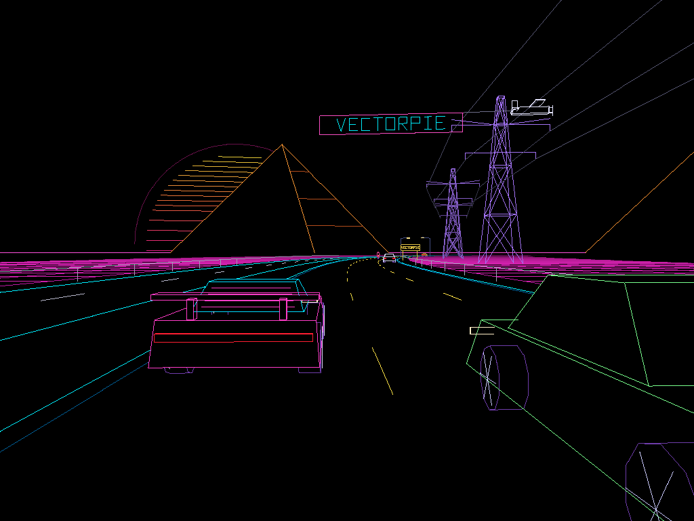
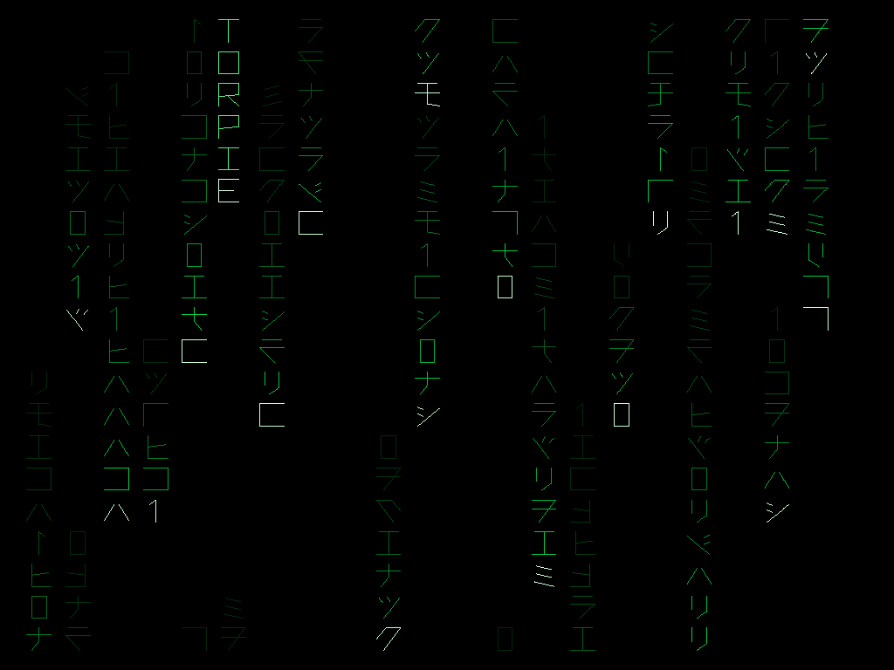
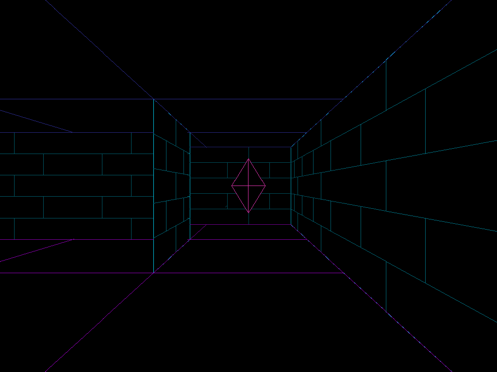
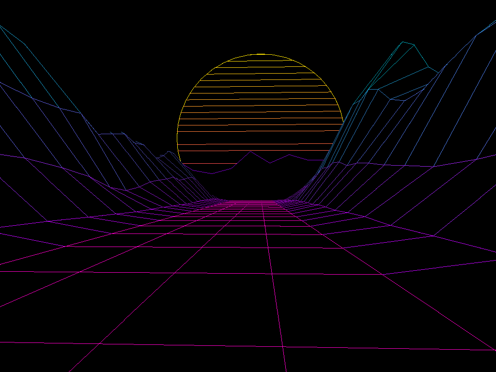
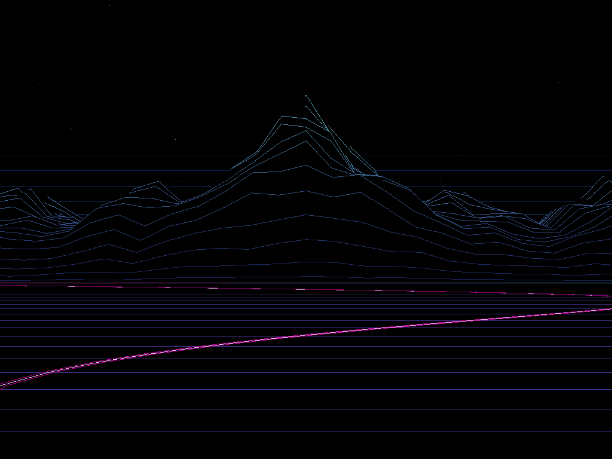
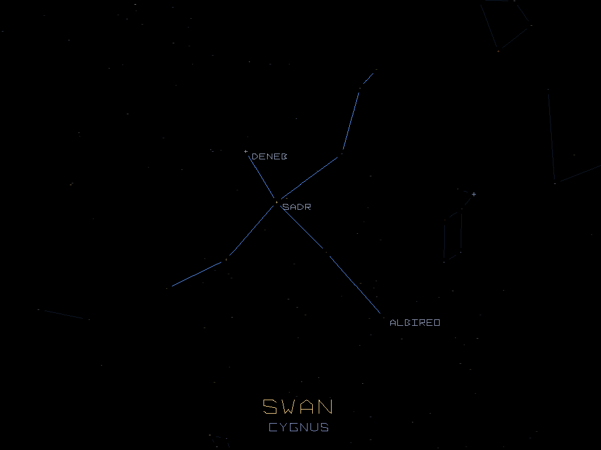
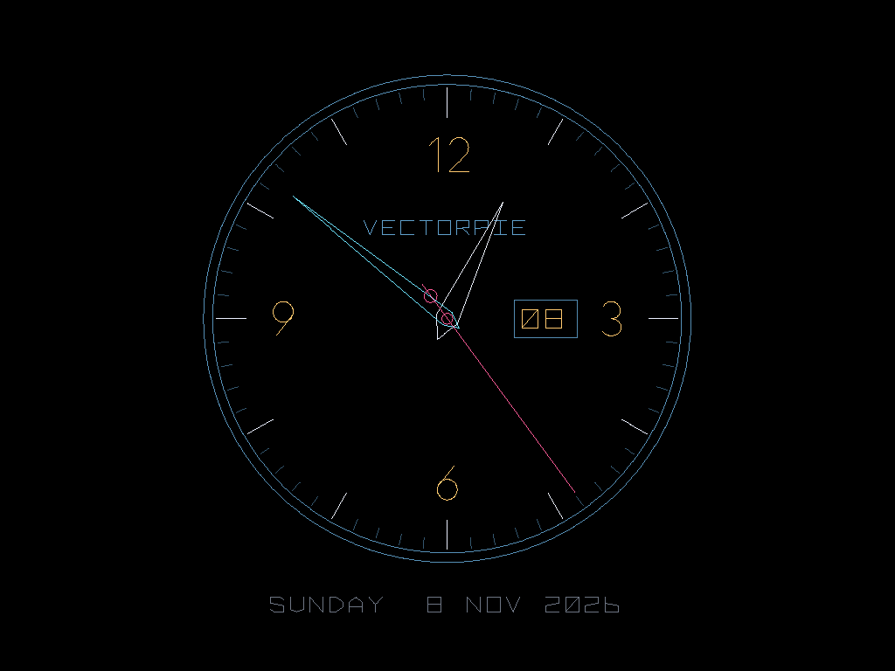
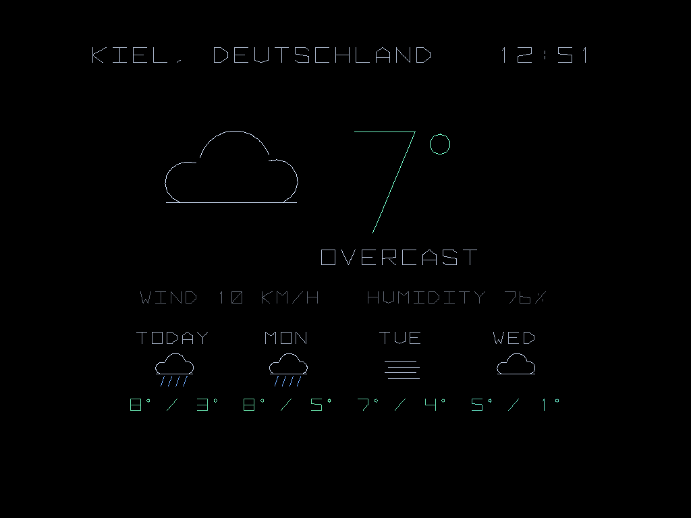
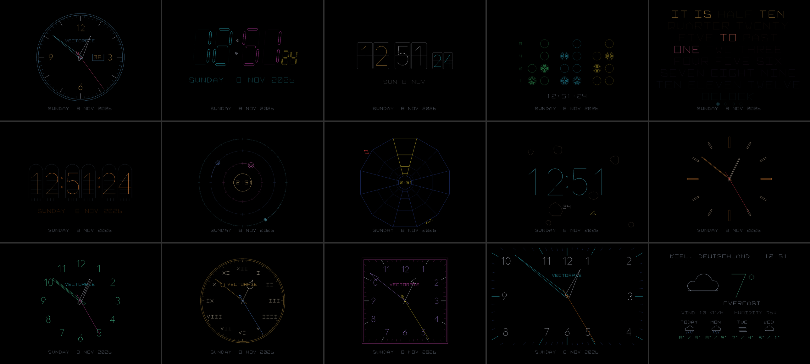

# VectorPie Screensavers

Screensaver apps for the **VectorPie** vector arcade cabinet. The cabinet starts one of these apps instead of its own screensaver. It draws on the vector monitor while the menu keeps playing its music.

Each screensaver has its own folder:

| Folder | Name | What it is |
|---|---|---|
| [`neondrive/`](neondrive/) | **Neon Drive** | An endless 80s synthwave drive in 3D: grid, sun, changing roads and scenery, traffic in both directions, birds and a plane towing a VECTORPIE banner. |
| [`digitalrain/`](digitalrain/) | **Digital Rain** | Green code rain in the Matrix style. Names of the cabinet's games keep falling with the rain, several at a time, and VECTORPIE. |
| [`labyrinth/`](labyrinth/) | **Labyrinth** | A walk through one maze after another, seen through the walker's eyes: patterned walls with VECTORPIE signs, spinning crystals and a cake as the exit. |
| [`neonpeaks/`](neonpeaks/) | **Neon Peaks** | Retrowave: a flight through a neon grid valley towards a striped sun. The music shapes the mountains on the horizon (its spectrum); speed and colors follow it smoothly. |
| [`neonridge/`](neonridge/) | **Neon Ridge** | Like the retrowave mountain videos: a starry sky, a glowing cyan horizon, a mountain range of contour lines, a plain of lines in front and a pink light trail. The camera stands still. |
| [`constellations/`](constellations/) | **Constellations** | A tour of the real night sky: 26 constellations draw themselves one after another, with English and Latin names and named bright stars. The stars twinkle, the Milky Way runs through, and now and then a shooting star falls. |
| [`clock/`](clock/) | **Clock** | The time on fifteen clock faces (six analog, digital, flip, binary, word clock, Nixie, orbit, tunnel, rocks, weather), with the date and the weather from the internet and a weather report in five views. Its own menu (F2 or Tab) sets face, random, change, switching (spinner, left/right, a custom button), colors, second hand, what is shown, weather report, place and language. |

## Screenshots

| | |
|---|---|
| **Neon Drive**  | **Digital Rain**  |
| **Labyrinth**  | **Neon Peaks**  |
| **Neon Ridge**  | **Constellations**  |
| **Clock**  | **Clock: weather**  |

**Clock: all fifteen faces**

Every screensaver takes these pictures itself: on a PC, `SAVER_SHOTS=<folder>` makes it save one every 2 seconds.

## Shared

- `vendor/VectorPie` – the VectorPie SDK (a copy); docs in `vendor/VectorPie/sdk/docs/`, for screensavers especially `09-screensavers.md`
- `cmake/` – the toolchain for the cabinet's Raspberry Pi
- `tools/` – build a package (`make_vps.sh`), put it on the cabinet (`deploy.sh`), run on a PC (`run_pc.bat`), make test music (`make_test_track.py`)
- `BUILD.md` – building, testing, installing, starting a new screensaver

## Installing

Ready-made packages of all screensavers are under [Releases](https://github.com/Endprodukt/VectorPieScreensavers/releases). To build them yourself: make the Pi build (see `BUILD.md`), then run `sh tools/make_vps.sh <folder>`. Install the `.vps` from USB in SETTINGS → SCREENSAVERS → INSTALL and choose it under SELECT. Or directly over SSH: `sh tools/deploy.sh <folder>`.
