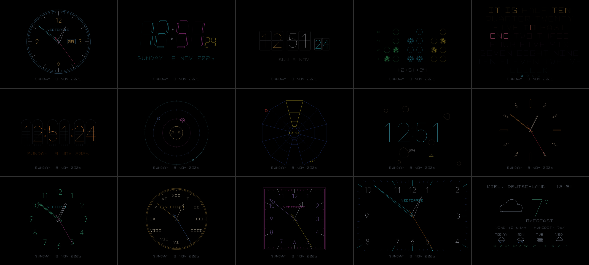
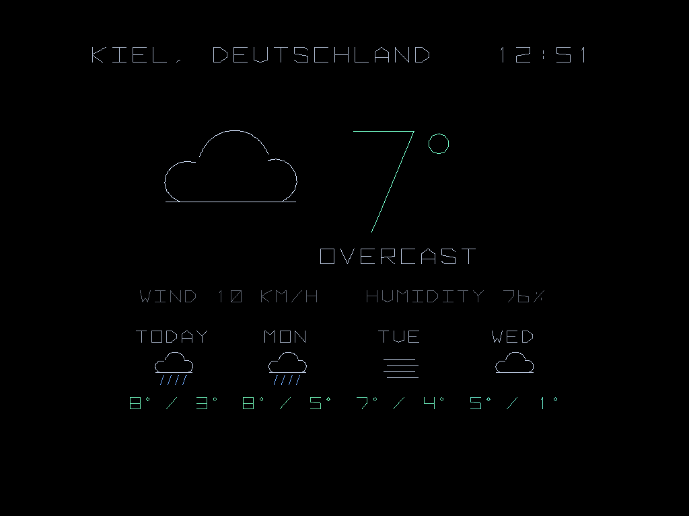

# Clock

The time on fifteen clock faces:

- **ANALOG:** a clock with rim, numbers and date window
- **MINIMAL:** no rim and no numbers, just twelve marks and slim hands
- **NUMERALS:** only the twelve numbers, baton hands
- **ROMAN:** Roman numerals, Breguet hands (with a ring before the tip)
- **SQUARE:** a square dial, arrow hands
- **FULL SCREEN:** no frame; the marks run along the screen edges and long pointed hands reach out to them
- **DIGITAL:** a seven-segment display with the date
- **FLIP:** a split-flap display whose cards flip over
- **BINARY:** each digit as bits
- **WORDS:** a word clock in the chosen language
- **NIXIE:** Nixie tubes
- **ORBIT:** hours, minutes and seconds circle like planets
- **TUNNEL:** a tube web like the old vector tube shooters
- **ROCKS:** drifting rocks and a little ship like the old vector rock shooters
- **WEATHER:** the weather now and for the next days

Each face has its own matching colors, for example on DIGITAL the hours are cyan, the minutes magenta and the seconds yellow. Below every face is a line with the date and the weather.

All fifteen faces in their own colors (from top left: ANALOG, DIGITAL, FLIP, BINARY, WORDS, NIXIE, ORBIT, TUNNEL, ROCKS, MINIMAL, NUMERALS, ROMAN, SQUARE, FULL SCREEN, WEATHER):

## The clock's menu

**F2 or Tab** opens it while the clock runs, and closes it again. Move around in it with the joystick. Button 1 or START 1 selects, button 2 or START 2 goes back and closes the menu. After a minute without input it closes by itself.

Settings:
- **FACE:** the clock face
- **RANDOM FACE:**
  - off (default)
  - a random face at start
  - always, so at every change too
- **CHANGE FACE:** whether the face changes by itself:
  - off (default)
  - with every track
  - every 1, 5, 15 or 60 minutes
  - after every weather report
- **SWITCH FACE WITH:** what steps to the next face:
  - SPINNER (default)
  - LEFT / RIGHT: joystick left and right
  - CUSTOM: a button of your own. Press button 1 on this line to learn it: "PRESS A BUTTON", then press the button you want (F2 or Tab cancels). The line then shows it, e.g. "CUSTOM: BUTTON 3".
  - NONE
- **CLOCK COLOR, DATE COLOR, WEATHER COLOR:** colors for clock, date and weather, each on its own. The choices:
  - ORIGINAL: the face's own colorful colors
  - one color for everything: cyan, green, amber, red, magenta, blue, white or rainbow
  - RANDOM SINGLE: a new color with every face, out of the seven plain ones, never the same twice in a row
  - RANDOM MULTI: new colorful colors with every face. All of the face's own colors are turned together by a random amount around the color wheel, so they still go together.
- **SECONDS:** off, SMOOTH (the hand glides, default) or TICK (it jumps every second)
- **What else is shown:** DATE, WEATHER LINE (the weather line below the clock), 24 HOURS (else 12) and TRACK TITLE, each on or off
- **WEATHER REPORT:** the full-screen weather report, off or every 1, 2, 3, 5, 10, 15, 30 or 60 minutes. It fades in over the clock and back again afterwards.
- **REPORT LENGTH:** how long it stays: 10, 20, 30 or 60 s
- **WEATHER STYLE:** how the weather is shown, in the report and on the WEATHER face:
  - OVERVIEW: now and the next 4 days
  - SIMPLE: a big symbol, temperature and weather
  - TODAY: plus feels-like temperature, min/max, rain, wind with direction, humidity, sunrise and sunset
  - DAYS: 7 days with min, max and chance of rain
  - HOURS: the next 24 hours as a temperature curve, with symbols and rain bars
  - ROTATING: the next view each time
- **WEATHER COLORS:** colorful (temperatures from blue to red, sun yellow, rain blue) or a single color in the weather color
- **PLACE:** the cabinet's local time, a city from the list, or any city found by searching with an on-screen keyboard. The place sets the time (with daylight saving time) and the weather.
- **LANGUAGE:** English (default), German, French, Spanish

The settings are kept in `save/clock.ini` next to the program.

The **spinner** (or whatever is set under SWITCH FACE WITH) steps through the faces. After the last one (and before the first) comes the weather report. It stays as long as set (REPORT LENGTH), even when the timed weather report is off. In the menu the spinner moves through the lines.

Outside the menu **START 2** plays the next track. Any other button, START 1 too, wakes the cabinet as with every screensaver.

- Running on a PC: double-click `run_pc.bat`. Tab, F2, Enter or M opens the menu, the arrow keys move in it (outside it, left and right step like the spinner), Backspace goes back, N plays the next track.
- State and open points: [STATUS.md](STATUS.md)
- For further work: [RESUME.md](RESUME.md)
- Building and installing: [../BUILD.md](../BUILD.md)
