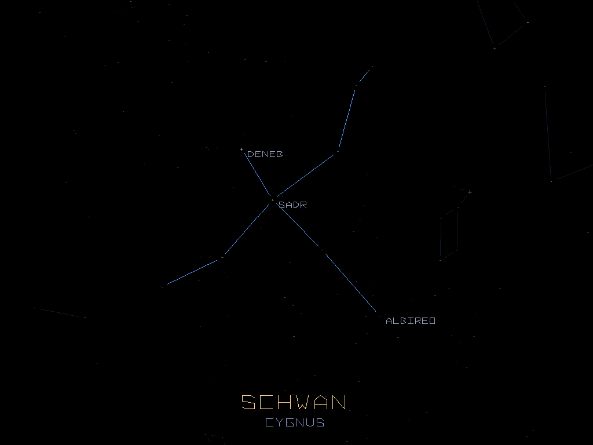

# Constellations

Ein langsamer Rundflug über den echten Nachthimmel. Der Blick gleitet von Sternbild zu Sternbild, jedes liegt neben dem letzten. Dort zeichnet sich die Figur ein, darunter stehen der deutsche und der lateinische Name, und die hellen Sterne werden benannt. Alle Sterne funkeln sanft, die Milchstraße zieht sich als dichteres Band durch den Himmel, und ab und zu fällt eine Sternschnuppe.

- Starten am PC: `run_pc.bat` per Doppelklick
- Stand und offene Punkte: [STATUS.md](STATUS.md)
- Für die Weiterarbeit: [RESUME.md](RESUME.md)
- Bauen und Installieren: [../BUILD.md](../BUILD.md)

