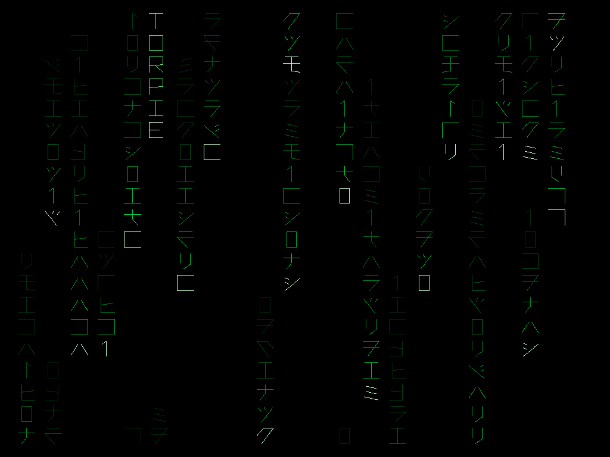

# Digital Rain

Green code raining down the vector monitor in columns. Names of the cabinet's games keep falling with it, several at a time, and **VECTORPIE**.

- Running on a PC: double-click `run_pc.bat`
- State and open points: [STATUS.md](STATUS.md)
- For further work: [RESUME.md](RESUME.md)
- Building and installing: [../BUILD.md](../BUILD.md)

