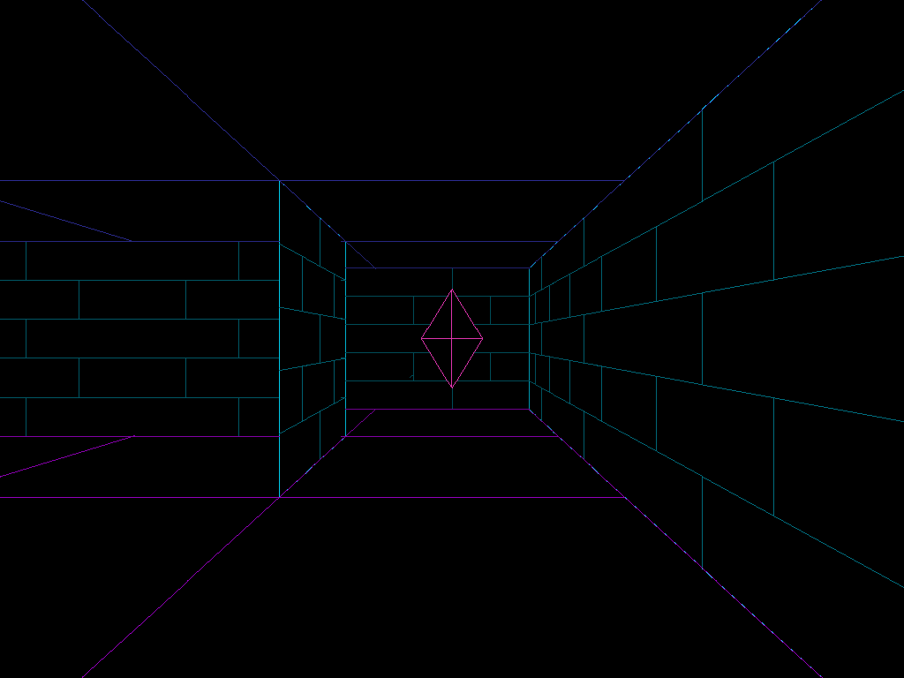

# Labyrinth

A walk through one maze after another, seen through the eyes of the one walking it. The idea comes from the classic maze screensaver on Windows, made here as a vector version of its own.

- Running on a PC: double-click `run_pc.bat`
- State and open points: [STATUS.md](STATUS.md)
- For further work: [RESUME.md](RESUME.md)
- Building and installing: [../BUILD.md](../BUILD.md)

