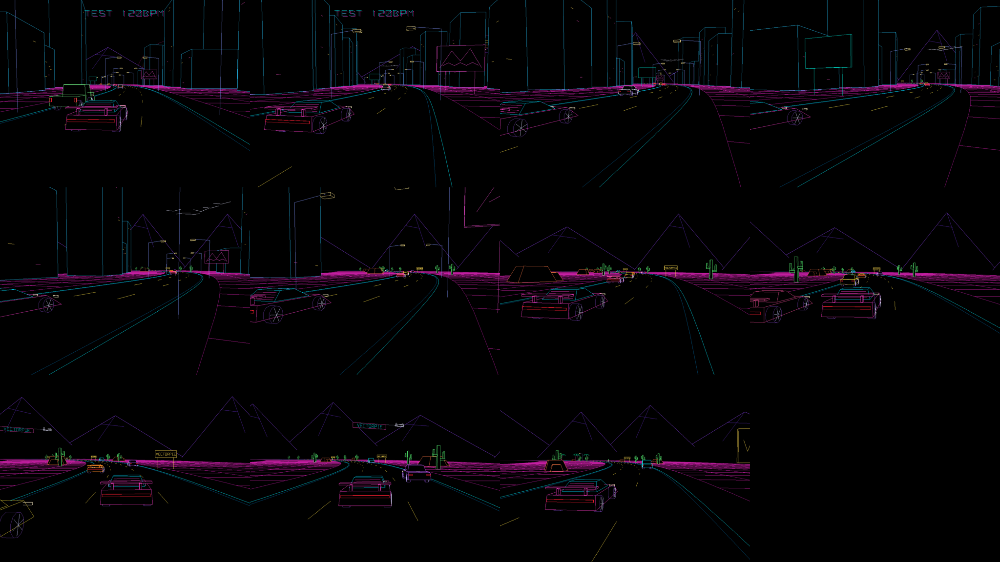

# Neon Drive

Eine endlose Fahrt im 80er-Synthwave-Stil, als 3D-Vektorgrafik für den VectorPie-Automaten:
- Neon-Grid und eine gestreifte Sonne
- wechselnde Strecken (Strand, Stadt, Wüste, Strommasten, Neon-Tunnel, Autobahn) und Kulissen am Horizont, die man nie erreicht
- Verkehr in beide Richtungen, dem das Auto ausweicht
- Vögel und ab und zu ein Flugzeug mit VECTORPIE-Banner

Nichts pulsiert oder blinkt; die Musik steuert nur gleitend Tempo und Verkehr.

- Starten am PC: `run_pc.bat` per Doppelklick
- Stand und offene Punkte: [STATUS.md](STATUS.md)
- Für die Weiterarbeit: [RESUME.md](RESUME.md)
- Bauen und Installieren: [../BUILD.md](../BUILD.md)

