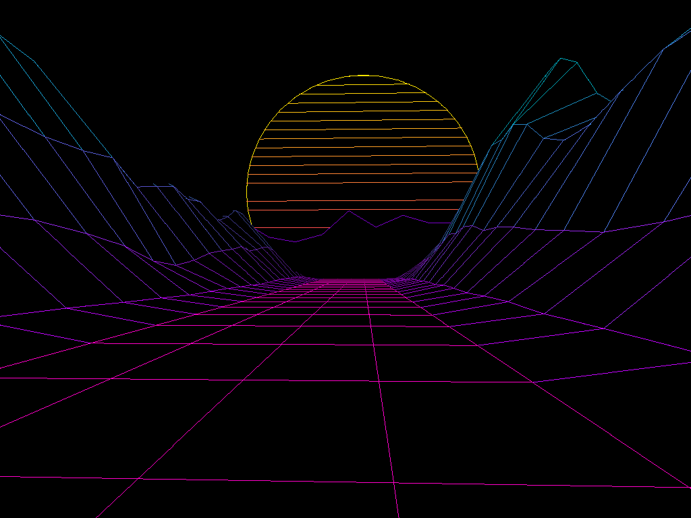

# Neon Peaks

Retrowave: a flight through a neon grid valley between wireframe mountains, towards a striped sun. The music builds the mountains.

- Running on a PC: double-click `run_pc.bat`
- State and open points: [STATUS.md](STATUS.md)
- For further work: [RESUME.md](RESUME.md)
- Building and installing: [../BUILD.md](../BUILD.md)

